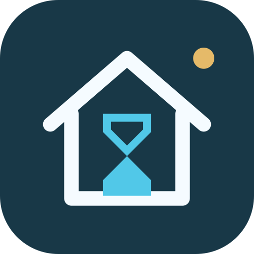
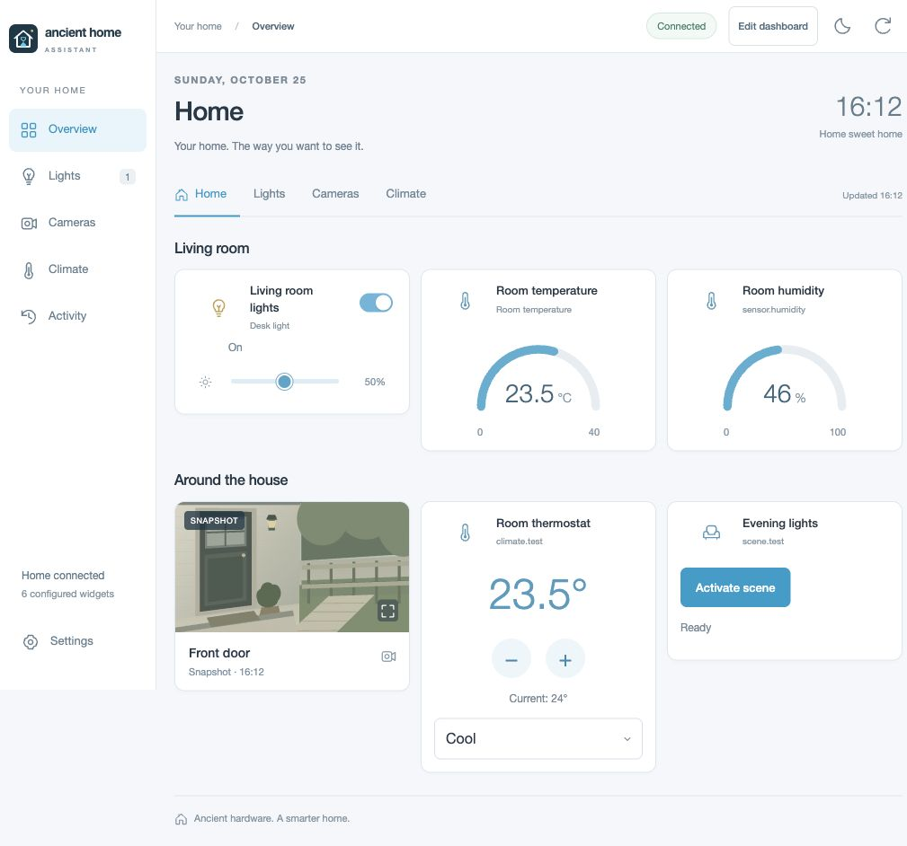
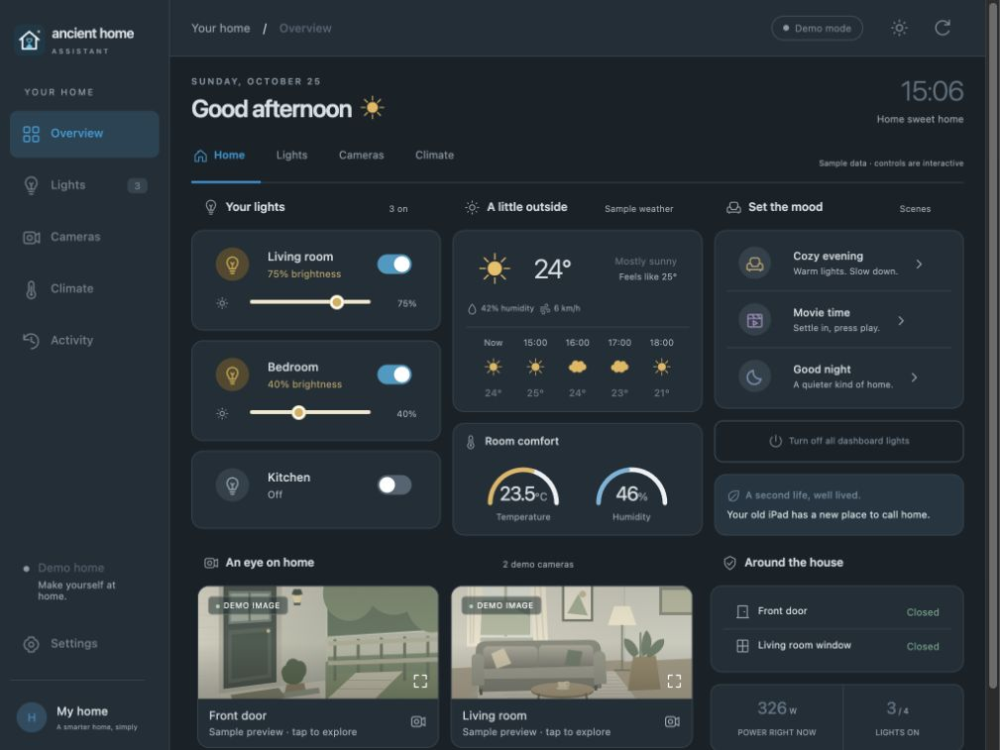

<p align="center">
  
</p>

<h1 align="center">Ancient Home Assistant</h1>

<p align="center">A lightweight Home Assistant dashboard for older iPads.</p>

Home Assistant-style cards, touch controls, and camera views in a buildless frontend targeting iOS 9 Safari. A small Python bridge handles authentication and API requests. Run it directly or deploy with Docker Compose.

## Example dashboard

The screenshots show the interactive demo with sample values and illustrated camera previews. No Home Assistant connection is required to explore it.



<details>
<summary>Dark mode</summary>



</details>

## Features

- Light and switch controls, brightness sliders, and Home Assistant scenes.
- Temperature and humidity gauges, current weather, and thermostat controls.
- Camera snapshots, optional MJPEG viewing, and native HLS/MP4 playback.
- Light and dark themes, responsive layouts, and 44-pixel switch targets.
- Settings to connect Home Assistant and map entities to dashboard cards.
- No frontend framework, CDN, package installation, or JavaScript build step.

Cards have a fixed, configurable layout. This is an independent client, not a full Lovelace dashboard renderer or Home Assistant administration interface.

## Quick start

### Docker one-liner

With Docker installed, start the published image:

```sh
docker run -d --name ancient-home-assistant --restart unless-stopped -p 8095:8095 --read-only --cap-drop ALL --security-opt no-new-privileges:true ghcr.io/leodenglovescode/ancienthomeassistant:latest
```

Open `http://SERVER_LAN_IP:8095` in a browser. The server and dashboard device must be able to reach each other over the network. The image supports **Linux AMD64 and ARM64**; no repository clone or local build is needed.

### Docker Compose

Save the following as `compose.yaml`:

```yaml
services:
  dashboard:
    image: ghcr.io/leodenglovescode/ancienthomeassistant:latest
    restart: unless-stopped
    ports:
      - "8095:8095"
    read_only: true
    cap_drop:
      - ALL
    security_opt:
      - no-new-privileges:true
    pids_limit: 96
    mem_limit: 192m
    cpus: 1.0
    logging:
      driver: json-file
      options:
        max-size: "5m"
        max-file: "2"
```

Start the dashboard:

```sh
docker compose up -d
docker compose ps
```

The repository's [compose.yaml](compose.yaml) additionally supports `ANCIENT_BIND_IP` and `ANCIENT_PORT` overrides through `.env`; see [.env.example](.env.example).

Docker publishes on all interfaces by default. Use a trusted LAN, or bind to a specific LAN address. Allow the selected port through the server firewall. The container runs as a non-root user with a read-only filesystem and a health check.

To update a Compose installation:

```sh
docker compose pull
docker compose up -d
```

For a `docker run` installation, pull the new image, remove the old container, and repeat the one-liner:

```sh
docker pull ghcr.io/leodenglovescode/ancienthomeassistant:latest
docker rm -f ancient-home-assistant
```

Restarting or recreating the container ends its in-memory Home Assistant sessions; reconnect in Settings. Entity mappings remain in the browser. Use either the one-liner or Compose for a given port, not both at once.

### Python

Requires Python 3.9 or newer; no third-party packages are needed.

```sh
python3 server.py
```

Open <http://127.0.0.1:8095>. To accept connections from other devices:

```sh
python3 server.py --host 0.0.0.0 --port 8095
```

## Connect Home Assistant

1. Open **Settings** in the dashboard.
2. Enter the Home Assistant base address reachable from the dashboard server, such as `http://homeassistant.local:8123`.
3. Create a long-lived access token in **Home Assistant → profile → Security** and enter it in Settings.
4. Select entities for the cards and choose **Save dashboard**.

Inside Docker, `127.0.0.1` refers to the dashboard container. Use the Home Assistant host's LAN address, or its service name on a shared Docker network. If `.local` names do not resolve inside the container, use an IP address or regular DNS name.

States refresh every five seconds while the page is visible. Unconfigured or unavailable entities remain labeled accordingly. The all-off action affects only the four configured light slots. Activity shows successful actions from the current dashboard session.

## Authentication

The browser connects to the same-origin Python bridge; Home Assistant CORS configuration is not required. Access tokens stay in server memory after connection and are not written to disk, logged, or saved in browser storage. An HttpOnly cookie identifies the session. Sessions expire after 12 hours or a server restart.

Entity mappings, theme, the server address, and optional video URLs are saved in the browser. Use a trusted LAN or compatible HTTPS: plain HTTP does not encrypt token submission or session traffic. Do not expose the dashboard directly to the internet or embed credentials in video URLs.

## Cameras and compatibility

| Mode | Behavior |
| --- | --- |
| Snapshots | Default. Uses Home Assistant's authenticated camera image proxy. Expanded views refresh every five seconds after a successful image. |
| MJPEG | Select in the camera viewer. Uses Home Assistant's camera stream proxy; integration support varies. |
| Native video | Configure an HLS `.m3u8` or MP4 URL in Settings. Safari opens the URL directly, so it must be reachable from the viewing device. |

For legacy iPads, H.264/AAC video at 480p or 720p is a practical starting point. Older Safari may need MPEG-TS HLS segments. RTSP, HEVC, and WebRTC sources require a compatible camera/NVR output or a separate transcoder; no transcoder is bundled. Native video requires a tap to play, and HTTPS pages need HTTPS video sources.

The frontend targets iPad 2 / iOS 9 Safari using ES5, XMLHttpRequest, inline SVG, and table/block layouts. It does not require CSS Grid, CSS variables, `fetch`, JavaScript modules, or service workers. Landscape (1024 × 768) and portrait (768 × 1024) layouts are included. Safari's **Add to Home Screen** option provides a standalone view.

Rendering and video decoding happen on the viewing device. Actual device behavior and camera playback depend on the OS version, codecs, network, and Home Assistant integration.

## Development

Build a local image from source:

```sh
docker build -t ancient-home-assistant:local .
```

The [publishing workflow](.github/workflows/publish-image.yml) runs the checks below and publishes AMD64/ARM64 images to GitHub Container Registry when application source changes on `main`. `latest` tracks the current published build; `sha-<full-commit-sha>` tags identify individual builds.


```sh
python3 -m unittest discover -s tests -v
node --check static/app.js
```

Bridge tests use a local fake Home Assistant server; no real credentials are required.

## References

- [Apple iPad 2 specifications](https://support.apple.com/en-in/111990)
- [Safari 9 JavaScript support](https://webkit.org/blog/4054/es6-in-webkit/)
- [Apple's archived Safari audio/video guide](https://developer.apple.com/library/archive/documentation/AudioVideo/Conceptual/Using_HTML5_Audio_Video/Introduction/Introduction.html)
- [Home Assistant tile cards](https://www.home-assistant.io/dashboards/tile/) and [REST API](https://developers.home-assistant.io/docs/api/rest/)

Not affiliated with or endorsed by Home Assistant.
