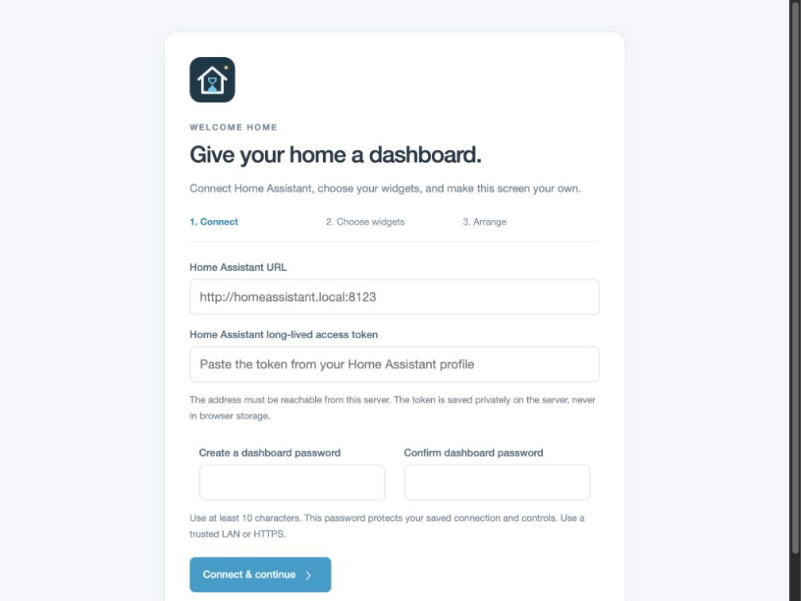

<p align="center">
  
</p>

<h1 align="center">Ancient Home Assistant</h1>

<p align="center">A customizable Home Assistant dashboard for older iPads.</p>

Home Assistant-style widgets in a lightweight frontend targeting iPad 2 and iOS 9 Safari. A Python bridge handles authentication, entity discovery, and persistent dashboard settings. No frontend framework, CDN, package installation, or JavaScript build step is required.

## Set up a real dashboard

A fresh installation opens onboarding, not a demo:

1. Enter the **Home Assistant URL** and **long-lived access token**.
2. Create a **dashboard password** to protect the saved connection and controls.
3. Search Home Assistant entities by name or entity ID, optionally filtering by widget type.
4. Choose compatible widgets, edit their titles, and arrange them into sections.
5. Finish setup. The connection and layout are saved on the server and restored after restarts.



Create a long-lived token in **Home Assistant → profile → Security**. The URL must be reachable from the dashboard server. Inside Docker, `127.0.0.1` refers to the container; use the Home Assistant host's LAN address or a service name on a shared Docker network. Use an IP or regular DNS name if `.local` does not resolve in Docker.

## Customize widgets

Choose **Edit dashboard** to add or remove widgets, rename them, change compatible widget types, rebind entities, move widgets between sections, change widths, or reorder widgets and sections. Set the dashboard title and one, two, or three columns. Layouts adapt to smaller screens. Touch-friendly up/down controls avoid reliance on drag-and-drop.

| Widget | Compatible entities |
| --- | --- |
| Light | `light` |
| Switch | `switch`, `input_boolean` |
| Gauge | Numeric `sensor`, `input_number`, `number` |
| Camera | `camera` |
| Thermostat | `climate` |
| Weather | `weather` |
| Scene | `scene` |
| Action button | `button`, `input_button`, `script` |
| Fan | `fan` |
| Cover | `cover` |
| Status / sensor | Read-only states for non-camera entities |

Type restrictions apply in the picker **and on the server**: a camera entity cannot be saved as a light widget, and a text sensor cannot be saved as a numeric gauge. Gauges support custom minimums, maximums, and unit labels. Cameras support optional native video URLs. Unsupported device domains can be displayed as read-only status widgets.

Changes are shared across browsers using the same installation. Concurrent edits are detected rather than silently overwriting another device's saved layout. This is an independent dashboard client, not a full Lovelace YAML renderer or Home Assistant administration interface.

## Example dashboard

These screenshots use example entities for illustration only. The deployed application does not load sample states, camera illustrations, or demo controls.


<details>
<summary>Dark mode</summary>


</details>

## Docker one-liner

With Docker installed:

```sh
docker run -d --name ancient-home-assistant --restart unless-stopped -p 8095:8095 -v ancient-home-assistant-data:/data --read-only --cap-drop ALL --security-opt no-new-privileges:true ghcr.io/leodenglovescode/ancienthomeassistant:latest
```

Open `http://SERVER_LAN_IP:8095`. Published images support **Linux AMD64 and ARM64**. The named volume is essential: it preserves credentials, login sessions, and widget layouts across container replacement.

## Docker Compose

Save this as `compose.yaml`:

```yaml
services:
  dashboard:
    image: ghcr.io/leodenglovescode/ancienthomeassistant:latest
    restart: unless-stopped
    ports:
      - "8095:8095"
    volumes:
      - dashboard-data:/data
    read_only: true
    cap_drop:
      - ALL
    security_opt:
      - no-new-privileges:true
    pids_limit: 96
    mem_limit: 192m
    cpus: 1.0
    logging:
      driver: json-file
      options:
        max-size: "5m"
        max-file: "2"

volumes:
  dashboard-data:
    name: ancient-home-assistant-data
```

Start it:

```sh
docker compose up -d
docker compose ps
```

The repository's [compose.yaml](compose.yaml) additionally supports LAN address, port, and volume-name overrides; see [.env.example](.env.example). Docker publishes on all interfaces by default. Use a trusted LAN or an HTTPS reverse proxy, and allow the selected port through the server firewall. Do not expose this application directly to the internet.

### Updates and migration

For Compose installations, keep the updated volume mapping above, then run:

```sh
docker compose pull
docker compose up -d
```

For a `docker run` installation, pull the image, remove the container, and repeat the one-liner **with the same named volume**:

```sh
docker pull ghcr.io/leodenglovescode/ancienthomeassistant:latest
docker rm -f ancient-home-assistant
```

The volume survives container removal. Do not remove it or use `docker compose down -v` unless intentionally deleting the dashboard and credentials. The one-liner and Compose example use the same volume name, so they can share saved data when switching installation methods; run only one installation at a time.

Upgrading from the original demo-based build requires completing onboarding once. Its browser-only mappings and temporary tokens are not migrated. Replace older Compose files with the volume-enabled example before upgrading.

## Storage and access

- `/data/dashboard.sqlite3` stores the Home Assistant connection, widget configuration, password hash, and hashed login session identifiers.
- The database is restricted to mode `0600` in a `0700` directory, owned by container UID `10001`. The remaining container filesystem stays read-only.
- The Home Assistant token is retrievable by the bridge, so it is stored in the private database **without database-level encryption**. Host administrators and anyone with access to the volume or its backups can read it. Protect backups and use host disk encryption if required.
- Dashboard passwords use salted PBKDF2-HMAC-SHA256 with 600,000 iterations. Passwords and raw session identifiers are not stored in the database. Login attempts are rate-limited.
- An HttpOnly, SameSite cookie keeps a browser signed in for up to 30 days, including across server restarts. Sign out to revoke that session. Changing the dashboard password revokes other sessions.
- The token is never returned by the API or stored in browser storage. Theme preference is stored locally. Use a trusted LAN or HTTPS: HTTP does not encrypt initial credentials or session traffic.

Update the Home Assistant URL/token or dashboard password in **Settings**. Leave the replacement token blank to retain it when the URL is unchanged. With an HTTPS reverse proxy, preserve the original Host header; `ANCIENT_COOKIE_SECURE=1` can enforce Secure cookies when running the server behind HTTPS.

Back up the named volume while the container is stopped or use SQLite's backup API. A filesystem copy of a database being actively written may be inconsistent. Bind-mounted directories must be writable by UID `10001`; named volumes receive the correct ownership automatically.

A server administrator can reset a forgotten dashboard password interactively without deleting the saved Home Assistant connection or widgets:

```sh
docker compose exec dashboard python server.py --reset-password
```

## Cameras and legacy Safari

Snapshots are the default and visible camera tiles refresh at most every 10 seconds. An expanded snapshot refreshes every five seconds after the preceding request completes. Open a camera to choose MJPEG if its Home Assistant integration supports it, or native HLS/MP4 if a direct URL has been configured. Background polling and camera refreshes pause when the page is hidden.

Native video URLs must be reachable from the iPad. Older Safari needs compatible H.264/AAC streams and may require MPEG-TS HLS segments. Tap Play; modern inline autoplay is not assumed. RTSP, HEVC, and WebRTC sources require a compatible camera/NVR output or a separate transcoder. No transcoder is bundled. Do not put credentials in video URLs, and use HTTPS video sources on HTTPS pages.

The UI uses **Helvetica Neue, Helvetica, Arial, and system sans-serif fonts**, ES5, XMLHttpRequest, inline SVG, and table/block layouts. No web fonts, CSS Grid, CSS variables, JavaScript modules, `fetch`, service workers, or WebRTC are required. Search results are paginated server-side; live state polling includes only configured entities. Landscape (1024 × 768) and portrait (768 × 1024) layouts are supported. Use Safari's **Add to Home Screen** for a standalone view.

Actual device rendering and video playback depend on the installed OS, camera codecs, and network. Desktop viewport checks do not establish physical iPad compatibility.

## Local development

Requires Python 3.9 or newer; no third-party Python packages are needed:

```sh
python3 server.py
```

Open <http://127.0.0.1:8095>. Local settings default to the ignored `data/` directory. Use `--host 0.0.0.0` for LAN access or `--data-dir /path/to/private/data` to choose a different storage directory.

```sh
python3 -m unittest discover -s tests -v
node --check static/app.js
docker build -t ancient-home-assistant:local .
```

Tests use a local Home Assistant fixture; no real credentials are required. The [publishing workflow](.github/workflows/publish-image.yml) tests the bridge and publishes AMD64/ARM64 images when application source changes on `main`. `latest` tracks the published build; `sha-<full-commit-sha>` tags identify individual builds.

## References

- [Apple iPad 2 specifications](https://support.apple.com/en-in/111990)
- [Safari 9 JavaScript support](https://webkit.org/blog/4054/es6-in-webkit/)
- [Home Assistant REST API](https://developers.home-assistant.io/docs/api/rest/)
- [OWASP password storage guidance](https://cheatsheetseries.owasp.org/cheatsheets/Password_Storage_Cheat_Sheet.html)

Not affiliated with or endorsed by Home Assistant.
